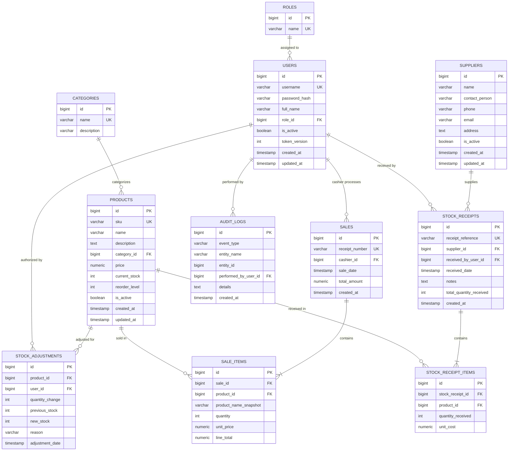

# System Design & Architecture Specification

## 1. System Architecture

```mermaid
flowchart TD
    subgraph EnvConfig ["Configuration Layer (Externalized Secrets)"]
        DotEnv[".env File / System Environment Variables"]
        AppYml["Spring Boot application.yml (${DB_URL}, ${JWT_SECRET}, etc.)"]
        AngularEnv["Angular environment.ts (API Base URL)"]
        DotEnv -->|Injects At Boot| AppYml
        DotEnv -->|Configures Build| AngularEnv
    end

    subgraph Client ["Frontend: Angular (Material Design)"]
        UI_Login["Login Screen (/login)"]
        UI_Cashier["Cashier POS & Receipts (/cashier/pos, /cashier/my-sales)"]
        UI_Inventory["Inventory Portal (/inventory/incoming, /inventory/low-stock)"]
        UI_Admin["Admin Management (/admin/products, /admin/sales, /admin/adjustments, /admin/reports)"]
        AuthGuard["Angular Auth & Role Route Guards"]
        JwtInterceptor["HTTP Interceptor (Bearer Token & Global Error Catching)"]
    end

    subgraph Backend ["Backend: Spring Boot 3 (Layered Architecture)"]
        SecFilterChain["Spring Security Filter Chain & Token Version Validation Filter"]
        
        subgraph Controllers ["REST Controller Layer"]
            C_Auth["AuthController (/api/v1/auth)"]
            C_Cat["CategoryController (/api/v1/categories)"]
            C_Pos["PosController (/api/v1/pos/products)"]
            C_Sale["SaleController (/api/v1/sales)"]
            C_Inv["InventoryController (/api/v1/inventory)"]
            C_Adm["AdminController (/api/v1/admin)"]
        end

        subgraph Services ["Service Layer (@Transactional)"]
            S_Auth["AuthService & UserDetailsService"]
            S_Sale["SaleService (Normalization, Pessimistic Locking & Atomic Multi-Item Rollback)"]
            S_Inv["InventoryService (Header Pre-calc & Atomic UPDATE RETURNING)"]
            S_Prod["ProductService"]
            S_Audit["AuditLogService (Sanitized Operational Events)"]
        end

        subgraph Persistence ["Persistence Layer"]
            R_Repos["Spring Data JPA Repositories (Pessimistic Locking)"]
            Hibernate["Hibernate (ddl-auto=validate)"]
            FlywayEngine["Flyway Migration Engine (V1__init, V2__seed)"]
        end

        GlobalEx["GlobalExceptionHandler (@RestControllerAdvice - RFC 7807)"]
    end

    subgraph CloudDB ["Database: Supabase PostgreSQL (Strict Free Plan)"]
        HikariPool["HikariCP Connection Pool (Max 5-10 Connections)"]
        PgSchema["PostgreSQL Schema with CHECK Constraints & Indexes"]
    end

    AngularEnv --> Client
    AppYml --> Backend
    Client -->|HTTPS REST with Bearer Token| SecFilterChain
    SecFilterChain --> Controllers
    Controllers --> Services
    Services --> Persistence
    R_Repos --> Hibernate
    Hibernate --> HikariPool
    FlywayEngine -->|Executes Schema on Startup| PgSchema
    HikariPool --> PgSchema
    GlobalEx -. RFC 7807 Error Responses .- Controllers
```



---

## 2. Database Entity-Relationship (ER) Diagram



---

## 3. Database Schema DDL (Flyway V1__initial_schema.sql)

```sql
CREATE TABLE roles (
    id BIGSERIAL PRIMARY KEY,
    name VARCHAR(30) UNIQUE NOT NULL
);

CREATE TABLE users (
    id BIGSERIAL PRIMARY KEY,
    username VARCHAR(50) UNIQUE NOT NULL,
    password_hash VARCHAR(255) NOT NULL,
    full_name VARCHAR(100) NOT NULL,
    role_id BIGINT NOT NULL REFERENCES roles(id) ON DELETE RESTRICT,
    is_active BOOLEAN NOT NULL DEFAULT TRUE,
    token_version INT NOT NULL DEFAULT 1,
    created_at TIMESTAMP WITH TIME ZONE NOT NULL DEFAULT CURRENT_TIMESTAMP,
    updated_at TIMESTAMP WITH TIME ZONE NOT NULL DEFAULT CURRENT_TIMESTAMP
);

CREATE TABLE categories (
    id BIGSERIAL PRIMARY KEY,
    name VARCHAR(100) UNIQUE NOT NULL,
    description VARCHAR(255)
);

CREATE TABLE suppliers (
    id BIGSERIAL PRIMARY KEY,
    name VARCHAR(150) NOT NULL,
    contact_person VARCHAR(100),
    phone VARCHAR(25),
    email VARCHAR(100),
    address TEXT,
    is_active BOOLEAN NOT NULL DEFAULT TRUE,
    created_at TIMESTAMP WITH TIME ZONE NOT NULL DEFAULT CURRENT_TIMESTAMP,
    updated_at TIMESTAMP WITH TIME ZONE NOT NULL DEFAULT CURRENT_TIMESTAMP
);

CREATE TABLE products (
    id BIGSERIAL PRIMARY KEY,
    sku VARCHAR(50) UNIQUE NOT NULL,
    name VARCHAR(150) NOT NULL,
    description TEXT,
    category_id BIGINT NOT NULL REFERENCES categories(id) ON DELETE RESTRICT,
    price NUMERIC(12, 2) NOT NULL CHECK (price >= 0),
    current_stock INT NOT NULL DEFAULT 0 CHECK (current_stock >= 0),
    reorder_level INT NOT NULL DEFAULT 5 CHECK (reorder_level >= 0),
    is_active BOOLEAN NOT NULL DEFAULT TRUE,
    created_at TIMESTAMP WITH TIME ZONE NOT NULL DEFAULT CURRENT_TIMESTAMP,
    updated_at TIMESTAMP WITH TIME ZONE NOT NULL DEFAULT CURRENT_TIMESTAMP
);

CREATE TABLE stock_receipts (
    id BIGSERIAL PRIMARY KEY,
    receipt_reference VARCHAR(60) UNIQUE NOT NULL,
    supplier_id BIGINT NOT NULL REFERENCES suppliers(id) ON DELETE RESTRICT,
    received_by_user_id BIGINT NOT NULL REFERENCES users(id) ON DELETE RESTRICT,
    received_date TIMESTAMP WITH TIME ZONE NOT NULL DEFAULT CURRENT_TIMESTAMP,
    notes TEXT,
    total_quantity_received INT NOT NULL CHECK (total_quantity_received > 0),
    created_at TIMESTAMP WITH TIME ZONE NOT NULL DEFAULT CURRENT_TIMESTAMP
);

CREATE TABLE stock_receipt_items (
    id BIGSERIAL PRIMARY KEY,
    stock_receipt_id BIGINT NOT NULL REFERENCES stock_receipts(id) ON DELETE RESTRICT,
    product_id BIGINT NOT NULL REFERENCES products(id) ON DELETE RESTRICT,
    quantity_received INT NOT NULL CHECK (quantity_received > 0),
    unit_cost NUMERIC(12, 2) NOT NULL DEFAULT 0.00 CHECK (unit_cost >= 0)
);

CREATE TABLE sales (
    id BIGSERIAL PRIMARY KEY,
    receipt_number VARCHAR(60) UNIQUE NOT NULL,
    cashier_id BIGINT NOT NULL REFERENCES users(id) ON DELETE RESTRICT,
    sale_date TIMESTAMP WITH TIME ZONE NOT NULL DEFAULT CURRENT_TIMESTAMP,
    total_amount NUMERIC(12, 2) NOT NULL CHECK (total_amount >= 0),
    created_at TIMESTAMP WITH TIME ZONE NOT NULL DEFAULT CURRENT_TIMESTAMP
);

CREATE TABLE sale_items (
    id BIGSERIAL PRIMARY KEY,
    sale_id BIGINT NOT NULL REFERENCES sales(id) ON DELETE RESTRICT,
    product_id BIGINT NOT NULL REFERENCES products(id) ON DELETE RESTRICT,
    product_name_snapshot VARCHAR(150) NOT NULL,
    quantity INT NOT NULL CHECK (quantity > 0),
    unit_price NUMERIC(12, 2) NOT NULL CHECK (unit_price >= 0),
    line_total NUMERIC(12, 2) NOT NULL CHECK (line_total >= 0)
);

CREATE TABLE stock_adjustments (
    id BIGSERIAL PRIMARY KEY,
    product_id BIGINT NOT NULL REFERENCES products(id) ON DELETE RESTRICT,
    user_id BIGINT NOT NULL REFERENCES users(id) ON DELETE RESTRICT,
    quantity_change INT NOT NULL CHECK (quantity_change != 0),
    previous_stock INT NOT NULL CHECK (previous_stock >= 0),
    new_stock INT NOT NULL CHECK (new_stock >= 0),
    reason VARCHAR(255) NOT NULL,
    adjustment_date TIMESTAMP WITH TIME ZONE NOT NULL DEFAULT CURRENT_TIMESTAMP
);

CREATE TABLE audit_logs (
    id BIGSERIAL PRIMARY KEY,
    event_type VARCHAR(50) NOT NULL,
    entity_name VARCHAR(50) NOT NULL,
    entity_id BIGINT NOT NULL,
    performed_by_user_id BIGINT NOT NULL REFERENCES users(id) ON DELETE RESTRICT,
    details TEXT,
    created_at TIMESTAMP WITH TIME ZONE NOT NULL DEFAULT CURRENT_TIMESTAMP
);

CREATE INDEX idx_products_category ON products(category_id);
CREATE INDEX idx_products_active_stock ON products(is_active, current_stock);
CREATE INDEX idx_sales_date_cashier ON sales(sale_date, cashier_id);
CREATE INDEX idx_stock_receipts_supplier ON stock_receipts(supplier_id);
CREATE INDEX idx_audit_logs_event_time ON audit_logs(event_type, created_at);
```

---

## 4. Key Architectural Clarifications

### 4.1 Per-User `token_version` Invalidation
* Each user has a `token_version` column (`INT NOT NULL DEFAULT 1`).
* JWT payload includes claim `"ver": user.getTokenVersion()`.
* On logout (`POST /api/v1/auth/logout`):
  ```sql
  UPDATE users SET token_version = token_version + 1, updated_at = NOW() WHERE id = :userId;
  ```
* In the JWT filter, if `token.ver != dbUser.getTokenVersion()`, access is immediately denied (`401 Unauthorized`).
* This ensures that logging out **invalidates all active tokens for that user** across all devices and sessions.

### 4.2 Checkout Concurrency Control & Row Locking
* Sale checkout runs in `@Transactional(isolation = Isolation.READ_COMMITTED)`.
* Products involved in a sale are sorted by `id` ascending (preventing deadlocks) and locked using `LockModeType.PESSIMISTIC_WRITE` (`SELECT ... FOR UPDATE`):
  ```java
  @Lock(LockModeType.PESSIMISTIC_WRITE)
  @Query("SELECT p FROM Product p WHERE p.id IN :ids ORDER BY p.id ASC")
  List<Product> findProductsForCheckoutWithLock(@Param("ids") List<Long> ids);
  ```
* While holding the exclusive lock:
  1. Active status is validated (`is_active == TRUE`).
  2. Stock availability is verified (`current_stock >= requested_quantity`).
  3. Authoritative unit price and product name are captured directly from the locked entity.
  4. Stock is decremented directly on the locked entity.
* If any product has insufficient stock or is inactive, an exception is thrown, rolling back the entire transaction.

## 5. Key Design Decisions

The following design decisions were made to ensure security, data consistency, maintainability, and suitability for a small retail environment.

1. **Frontend and Backend Separation:** Angular is used for the frontend, while Spring Boot provides REST APIs. This separation allows the frontend and backend to be developed and maintained independently.

2. **PostgreSQL Database:** Supabase PostgreSQL is used for persistent storage of users, products, suppliers, sales, stock receipts, and audit records.

3. **JWT-Based Authentication:** JSON Web Tokens are used for stateless authentication. Spring Security enforces role-based authorization to restrict access to protected operations.

4. **BCrypt Password Hashing:** Passwords are stored as BCrypt hashes instead of plain-text values to improve account security.

5. **Flyway Database Migrations:** Flyway manages version-controlled database schema creation and initial data seeding, ensuring consistent database setup across environments.

6. **Transactional Stock Management:** Database transactions are used for sales and stock receipt operations to maintain consistency between transaction records and inventory quantities.

7. **Pessimistic Locking:** Product records are locked during checkout to prevent concurrent transactions from selling more stock than is available.

8. **Soft Deactivation:** Products and suppliers are deactivated instead of permanently deleted wherever historical records must be preserved.

9. **Centralized Exception Handling:** A global exception handler provides structured error responses using Spring's ProblemDetail support.

10. **Externalized Configuration:** Database credentials, JWT secrets, server settings, and CORS origins are supplied through environment variables rather than hardcoded production values.

## 6. Assumptions

The system is designed based on the following assumptions:

1. The application is intended for internal use in a small retail shop and does not provide a public customer-facing portal.

2. The system supports three user roles: ADMIN (Manager), CASHIER, and INVENTORY_STAFF.

3. Users must authenticate before accessing protected application features.

4. The ADMIN manages products, categories, suppliers, staff accounts, stock adjustments, and management reports.

5. CASHIER users are responsible for processing sales and accessing their permitted sales and receipt information.

6. INVENTORY_STAFF users are responsible for recording incoming stock and monitoring low-stock products.

7. Product stock changes through incoming stock receipts, completed sales, and authorized stock adjustments.

8. Product prices and available stock maintained by the backend database are treated as the authoritative values during checkout.

9. Historical sales and stock receipt records must remain available even when related products or suppliers are deactivated.

## 7. Known Gaps and Current Limitations

The following items require further verification or enhancement:

1. **Live Workflow Verification:** Although the application has been deployed, all end-to-end workflows, including cashier checkout, receipt generation, stock deduction, and reporting, must be verified in the deployed environment.

2. **Swagger Authentication:** JWT authentication support has been added to the OpenAPI configuration. Its availability and successful execution of protected endpoints must be verified after deployment.

3. **Free-Tier Hosting:** The application uses free-tier hosting services. Backend inactivity may result in delayed responses while the service starts again.

4. **External Backup Management:** A separate automated database backup and recovery strategy has not yet been established as part of the application workflow.

## 8. Possible Future Improvements

The following enhancements may be considered in future versions:

1. **Barcode Scanner Integration:** Support barcode scanning to identify products quickly during checkout and inventory operations.

2. **Automated Low-Stock Notifications:** Introduce automatic notifications when product quantities reach their configured reorder levels.

3. **Advanced Analytics:** Provide additional sales trends, product performance analysis, and inventory movement reports.

4. **Report Export Enhancements:** Support additional export formats for sales, stock receipts, inventory, and audit reports.

5. **Automated Backup and Recovery:** Introduce a documented and automated database backup and recovery strategy.

6. **Performance Monitoring:** Add application performance monitoring and alerting to identify slow API responses and operational issues.

7. **Automated Deployment:** Improve the deployment process through a CI/CD pipeline with automated build and test execution.

---

## 9. Conclusion

The system follows a layered architecture with a clear separation between the frontend, backend, and database. Security controls, transactional inventory operations, database constraints, and audit records are incorporated to support reliable retail operations. The design also allows future enhancements without requiring major changes to the existing architecture.
