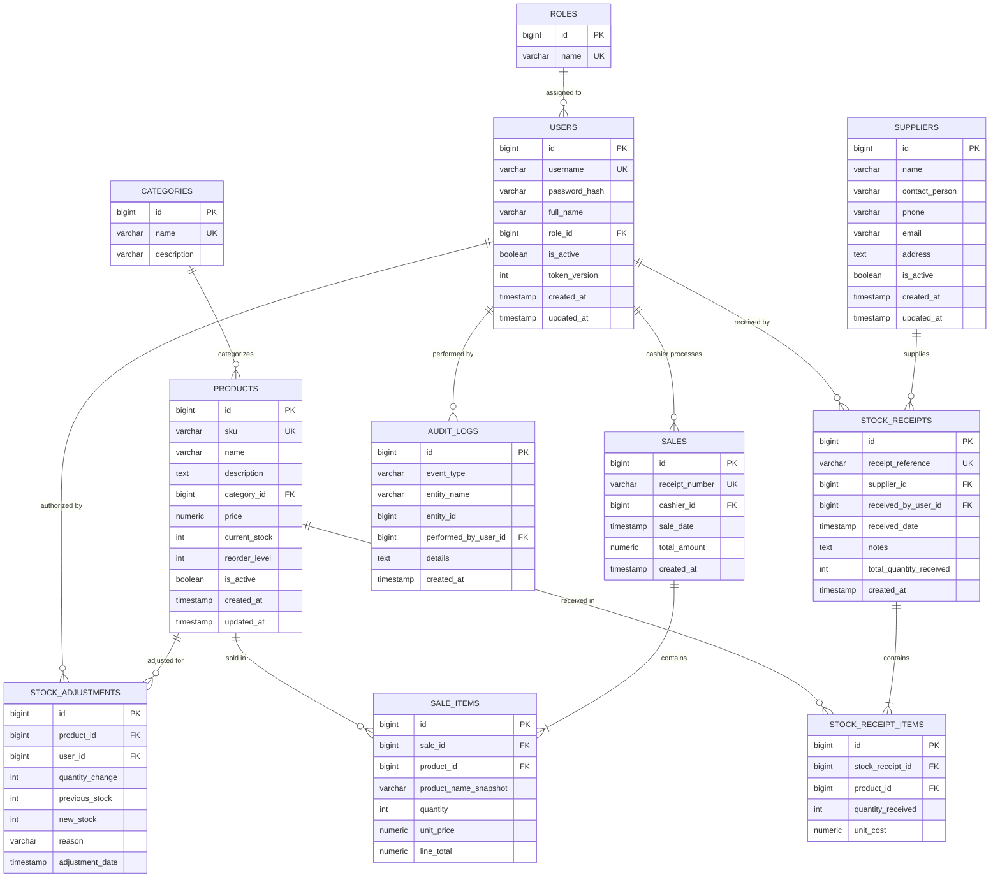

# System Design & Architecture Specification

## 1. System Architecture

```mermaid
flowchart TD
    subgraph EnvConfig ["Configuration Layer (Externalized Secrets)"]
        DotEnv[".env File / System Environment Variables"]
        AppYml["Spring Boot application.yml (${DB_URL}, ${JWT_SECRET}, etc.)"]
        AngularEnv["Angular environment.ts (API Base URL)"]
        DotEnv -->|Injects At Boot| AppYml
        DotEnv -->|Configures Build| AngularEnv
    end

    subgraph Client ["Frontend: Angular (Material Design)"]
        UI_Login["Login Screen (/login)"]
        UI_Cashier["Cashier POS & Receipts (/cashier/pos, /cashier/my-sales)"]
        UI_Inventory["Inventory Portal (/inventory/incoming, /inventory/low-stock)"]
        UI_Admin["Admin Management (/admin/products, /admin/sales, /admin/adjustments, /admin/reports)"]
        AuthGuard["Angular Auth & Role Route Guards"]
        JwtInterceptor["HTTP Interceptor (Bearer Token & Global Error Catching)"]
    end

    subgraph Backend ["Backend: Spring Boot 3 (Layered Architecture)"]
        SecFilterChain["Spring Security Filter Chain & Token Version Validation Filter"]
        
        subgraph Controllers ["REST Controller Layer"]
            C_Auth["AuthController (/api/v1/auth)"]
            C_Cat["CategoryController (/api/v1/categories)"]
            C_Pos["PosController (/api/v1/pos/products)"]
            C_Sale["SaleController (/api/v1/sales)"]
            C_Inv["InventoryController (/api/v1/inventory)"]
            C_Adm["AdminController (/api/v1/admin)"]
        end

        subgraph Services ["Service Layer (@Transactional)"]
            S_Auth["AuthService & UserDetailsService"]
            S_Sale["SaleService (Normalization, Pessimistic Locking & Atomic Multi-Item Rollback)"]
            S_Inv["InventoryService (Header Pre-calc & Atomic UPDATE RETURNING)"]
            S_Prod["ProductService"]
            S_Audit["AuditLogService (Sanitized Operational Events)"]
        end

        subgraph Persistence ["Persistence Layer"]
            R_Repos["Spring Data JPA Repositories (Pessimistic Locking)"]
            Hibernate["Hibernate (ddl-auto=validate)"]
            FlywayEngine["Flyway Migration Engine (V1__init, V2__seed)"]
        end

        GlobalEx["GlobalExceptionHandler (@RestControllerAdvice - RFC 7807)"]
    end

    subgraph CloudDB ["Database: Supabase PostgreSQL (Strict Free Plan)"]
        HikariPool["HikariCP Connection Pool (Max 5-10 Connections)"]
        PgSchema["PostgreSQL Schema with CHECK Constraints & Indexes"]
    end

    AngularEnv --> Client
    AppYml --> Backend
    Client -->|HTTPS REST with Bearer Token| SecFilterChain
    SecFilterChain --> Controllers
    Controllers --> Services
    Services --> Persistence
    R_Repos --> Hibernate
    Hibernate --> HikariPool
    FlywayEngine -->|Executes Schema on Startup| PgSchema
    HikariPool --> PgSchema
    GlobalEx -. RFC 7807 Error Responses .- Controllers
```



---

## 2. Database Entity-Relationship (ER) Diagram



---

## 3. Database Schema DDL (Flyway V1__initial_schema.sql)

```sql
CREATE TABLE roles (
    id BIGSERIAL PRIMARY KEY,
    name VARCHAR(30) UNIQUE NOT NULL
);

CREATE TABLE users (
    id BIGSERIAL PRIMARY KEY,
    username VARCHAR(50) UNIQUE NOT NULL,
    password_hash VARCHAR(255) NOT NULL,
    full_name VARCHAR(100) NOT NULL,
    role_id BIGINT NOT NULL REFERENCES roles(id) ON DELETE RESTRICT,
    is_active BOOLEAN NOT NULL DEFAULT TRUE,
    token_version INT NOT NULL DEFAULT 1,
    created_at TIMESTAMP WITH TIME ZONE NOT NULL DEFAULT CURRENT_TIMESTAMP,
    updated_at TIMESTAMP WITH TIME ZONE NOT NULL DEFAULT CURRENT_TIMESTAMP
);

CREATE TABLE categories (
    id BIGSERIAL PRIMARY KEY,
    name VARCHAR(100) UNIQUE NOT NULL,
    description VARCHAR(255)
);

CREATE TABLE suppliers (
    id BIGSERIAL PRIMARY KEY,
    name VARCHAR(150) NOT NULL,
    contact_person VARCHAR(100),
    phone VARCHAR(25),
    email VARCHAR(100),
    address TEXT,
    is_active BOOLEAN NOT NULL DEFAULT TRUE,
    created_at TIMESTAMP WITH TIME ZONE NOT NULL DEFAULT CURRENT_TIMESTAMP,
    updated_at TIMESTAMP WITH TIME ZONE NOT NULL DEFAULT CURRENT_TIMESTAMP
);

CREATE TABLE products (
    id BIGSERIAL PRIMARY KEY,
    sku VARCHAR(50) UNIQUE NOT NULL,
    name VARCHAR(150) NOT NULL,
    description TEXT,
    category_id BIGINT NOT NULL REFERENCES categories(id) ON DELETE RESTRICT,
    price NUMERIC(12, 2) NOT NULL CHECK (price >= 0),
    current_stock INT NOT NULL DEFAULT 0 CHECK (current_stock >= 0),
    reorder_level INT NOT NULL DEFAULT 5 CHECK (reorder_level >= 0),
    is_active BOOLEAN NOT NULL DEFAULT TRUE,
    created_at TIMESTAMP WITH TIME ZONE NOT NULL DEFAULT CURRENT_TIMESTAMP,
    updated_at TIMESTAMP WITH TIME ZONE NOT NULL DEFAULT CURRENT_TIMESTAMP
);

CREATE TABLE stock_receipts (
    id BIGSERIAL PRIMARY KEY,
    receipt_reference VARCHAR(60) UNIQUE NOT NULL,
    supplier_id BIGINT NOT NULL REFERENCES suppliers(id) ON DELETE RESTRICT,
    received_by_user_id BIGINT NOT NULL REFERENCES users(id) ON DELETE RESTRICT,
    received_date TIMESTAMP WITH TIME ZONE NOT NULL DEFAULT CURRENT_TIMESTAMP,
    notes TEXT,
    total_quantity_received INT NOT NULL CHECK (total_quantity_received > 0),
    created_at TIMESTAMP WITH TIME ZONE NOT NULL DEFAULT CURRENT_TIMESTAMP
);

CREATE TABLE stock_receipt_items (
    id BIGSERIAL PRIMARY KEY,
    stock_receipt_id BIGINT NOT NULL REFERENCES stock_receipts(id) ON DELETE RESTRICT,
    product_id BIGINT NOT NULL REFERENCES products(id) ON DELETE RESTRICT,
    quantity_received INT NOT NULL CHECK (quantity_received > 0),
    unit_cost NUMERIC(12, 2) NOT NULL DEFAULT 0.00 CHECK (unit_cost >= 0)
);

CREATE TABLE sales (
    id BIGSERIAL PRIMARY KEY,
    receipt_number VARCHAR(60) UNIQUE NOT NULL,
    cashier_id BIGINT NOT NULL REFERENCES users(id) ON DELETE RESTRICT,
    sale_date TIMESTAMP WITH TIME ZONE NOT NULL DEFAULT CURRENT_TIMESTAMP,
    total_amount NUMERIC(12, 2) NOT NULL CHECK (total_amount >= 0),
    created_at TIMESTAMP WITH TIME ZONE NOT NULL DEFAULT CURRENT_TIMESTAMP
);

CREATE TABLE sale_items (
    id BIGSERIAL PRIMARY KEY,
    sale_id BIGINT NOT NULL REFERENCES sales(id) ON DELETE RESTRICT,
    product_id BIGINT NOT NULL REFERENCES products(id) ON DELETE RESTRICT,
    product_name_snapshot VARCHAR(150) NOT NULL,
    quantity INT NOT NULL CHECK (quantity > 0),
    unit_price NUMERIC(12, 2) NOT NULL CHECK (unit_price >= 0),
    line_total NUMERIC(12, 2) NOT NULL CHECK (line_total >= 0)
);

CREATE TABLE stock_adjustments (
    id BIGSERIAL PRIMARY KEY,
    product_id BIGINT NOT NULL REFERENCES products(id) ON DELETE RESTRICT,
    user_id BIGINT NOT NULL REFERENCES users(id) ON DELETE RESTRICT,
    quantity_change INT NOT NULL CHECK (quantity_change != 0),
    previous_stock INT NOT NULL CHECK (previous_stock >= 0),
    new_stock INT NOT NULL CHECK (new_stock >= 0),
    reason VARCHAR(255) NOT NULL,
    adjustment_date TIMESTAMP WITH TIME ZONE NOT NULL DEFAULT CURRENT_TIMESTAMP
);

CREATE TABLE audit_logs (
    id BIGSERIAL PRIMARY KEY,
    event_type VARCHAR(50) NOT NULL,
    entity_name VARCHAR(50) NOT NULL,
    entity_id BIGINT NOT NULL,
    performed_by_user_id BIGINT NOT NULL REFERENCES users(id) ON DELETE RESTRICT,
    details TEXT,
    created_at TIMESTAMP WITH TIME ZONE NOT NULL DEFAULT CURRENT_TIMESTAMP
);

CREATE INDEX idx_products_category ON products(category_id);
CREATE INDEX idx_products_active_stock ON products(is_active, current_stock);
CREATE INDEX idx_sales_date_cashier ON sales(sale_date, cashier_id);
CREATE INDEX idx_stock_receipts_supplier ON stock_receipts(supplier_id);
CREATE INDEX idx_audit_logs_event_time ON audit_logs(event_type, created_at);
```

---

## 4. Key Architectural Clarifications

### 4.1 Per-User `token_version` Invalidation
* Each user has a `token_version` column (`INT NOT NULL DEFAULT 1`).
* JWT payload includes claim `"ver": user.getTokenVersion()`.
* On logout (`POST /api/v1/auth/logout`):
  ```sql
  UPDATE users SET token_version = token_version + 1, updated_at = NOW() WHERE id = :userId;
  ```
* In the JWT filter, if `token.ver != dbUser.getTokenVersion()`, access is immediately denied (`401 Unauthorized`).
* This ensures that logging out **invalidates all active tokens for that user** across all devices and sessions.

### 4.2 Checkout Concurrency Control & Row Locking
* Sale checkout runs in `@Transactional(isolation = Isolation.READ_COMMITTED)`.
* Products involved in a sale are sorted by `id` ascending (preventing deadlocks) and locked using `LockModeType.PESSIMISTIC_WRITE` (`SELECT ... FOR UPDATE`):
  ```java
  @Lock(LockModeType.PESSIMISTIC_WRITE)
  @Query("SELECT p FROM Product p WHERE p.id IN :ids ORDER BY p.id ASC")
  List<Product> findProductsForCheckoutWithLock(@Param("ids") List<Long> ids);
  ```
* While holding the exclusive lock:
  1. Active status is validated (`is_active == TRUE`).
  2. Stock availability is verified (`current_stock >= requested_quantity`).
  3. Authoritative unit price and product name are captured directly from the locked entity.
  4. Stock is decremented directly on the locked entity.
* If any product has insufficient stock or is inactive, an exception is thrown, rolling back the entire transaction.
